# 神州八劍：dosgolem 與 HD 音畫

以 dosgolem 執行原版 DOS 程式，逐步接入 HD 圖像、Noto 粗字與 HD 音樂。玩法、劇情、事件及存檔仍由原版程式控制。

原版遊戲、手冊及完整執行期音畫素材不隨本倉庫提供。經使用者批准的定稿與成果圖另存 `docs/images/`。執行研究工具須自備合法來源資料；目前沒有供玩家下載的完整遊戲包。

## 關於這款遊戲

《神州八劍》（The Other Side of the Predella）是一款中文 DOS 奇幻角色扮演遊戲，原版包裝標示 1991 年智冠科技版權。故事從一幅名為「地獄變」的古畫展開：靖南王把雪環公主帶入畫中，歷經千年後，畫內八國陷入他的統治。玩家扮演進入畫中的年少英雄，尋找名劍與法術，聯合反抗勢力，救回公主。

冒險結合地圖探索、英雄養成與軍隊作戰。玩家沿路探索城鎮與野外、招募和管理軍隊、尋找寶物，並在戰鬥與旅途中使用法術。原版採鍵盤操作，右側七項指令提供人物、軍隊、法術、地圖、搜尋與存取功能。手冊另記載音樂欣賞模式，可聆聽 AdLib 配樂。

介紹依據為原版手冊印頁 1–2、7–10 與包裝背面。掃描檔只留本機，來源名稱、雜湊及內容定位見[研究紀錄](RESEARCH-LOG.md#遊戲介紹與字型樣張的來源)。手冊所載玩法與本專案已驗證的範圍分開記錄。

## 重製方向與現況

部隊特性、策略 AI 與法術動畫的擴充方案見[戰術增強提案](docs/spec/030-battle-expansion-proposal.md)。已確認保留原版規則並新增獨立戰術增強模式，尚未接入新玩法；AI 從原版判斷掛點切入。HD 配色與規則模式分開，採保留玉綠、金框、黑底與朱紅的[原概念圖修色](docs/spec/031-hd-palette-refinement.md)。

| 面向 | 目前狀態 |
|---|---|
| 原版執行 | 已透過 dosgolem 冷啟動、新遊戲、地圖移動、存檔、退出，再冷啟動載入進度 |
| 顯示相容性 | 已修正原版切換顯示頁後的黑畫面；[BIOS 顯示頁規格](docs/spec/001-planar-bios-display-pages.md)記錄驗證範圍 |
| HD 圖像 | 已接入 B 古風地表、建築與六塊城堡、布旗與無旗太極圖、十二張主角動作、人物頁、金玉介面、深藍故事背景、山谷與攻城背景、25 組部隊／怪物的 100 筆姿勢、火花與四姿態陰陽圖案。新增 20 組支援兩向與軍隊／戰場用途，沿共用機制代表抽驗。正常移動、頁面往返及真正存退讀已驗；沙地實景與其他圖像仍待處理。部隊範圍見 [048](docs/spec/048-troop-hd-batch.md#正式接入與限定驗收)，其餘範圍見 [014](docs/spec/014-intro-story-background.md)、[021](docs/spec/021-battle-background-pages.md)、[027](docs/spec/027-battle-pon-effects.md)、[029](docs/spec/029-battle-choi-markers.md)及 [045](docs/spec/045-map-landmarks.md#第-48-筆正式提升與限定驗收) |
| HD 文字 | 預設 Noto Sans CJK TC Black 900，包含 PAM 的 636 字與 95 個 ASCII、片頭標題、五頁直排故事、四組製作名單與發行商圖片文字。新素材組可由工具列或 F10 切換教育部隸書、草書並保留偏好，範圍見 [015](docs/spec/015-font-settings.md)及 [016](docs/spec/016-publisher-wordmarks.md)。已驗啟動選項、主選單、人物、軍隊、無法施法提示、地圖位置及系統選單；其他圖片文字與長文仍待處理 |
| HD 音樂 | 〈幻〉B 撥弦／長笛已接入音樂欣賞與片頭，選曲、重播、循環、停止及回退通過；實際視窗混音與存退讀亦已核對。其餘曲目仍為原版，音訊裝置及完整音效待驗。見 [008](docs/spec/008-music-events-and-playback.md)／[009](docs/spec/009-intro-music-handoff.md) |
| 玩家前端 | 已有開發用視窗、兩側手繪海報與字型工具列，可切換經典封面、龍虎延展及關閉，具有內側漸淡與 400 ms 淡入淡出。正常點選、取消、失焦、偏好恢復及人物／軍隊往返已驗，見 [032](docs/spec/032-poster-toolbar.md)。效能、音訊連續性、戰鬥規則及完整流程仍待驗，尚無正式交付包 |

目前狀態與證據入口集中在 [CONTEXT.md](CONTEXT.md)。[自有 HD 場景呈現器](docs/spec/047-hd-scene-renderer.md#正式提升與限定驗收)已接入正式入口，直接從來源圖像、角色、文字與頁面命令產生完整畫面，不再以原版 RGB 畫面墊底。已驗的選單、人物／軍隊及募兵交易完成後才提交；四／五平面圖片與六平面角色沿事件邊界接管像素迴圈，保留原版需要的索引平面讀回。自然開場、工具列三字型與真正存退讀已抽驗，來源故障會明確停止。其餘音畫、未抽驗玩家分支及整體效能仍待完成。

開場博物館已接入紫藍手繪左右展間、十個人物動作、中國古典美女特寫與兩色光束，保留原版劇情、切鏡及字幕，範圍見 [017](docs/spec/017-intro-museum-art.md#正式接入與限定驗收)及 [033](docs/spec/033-intro-heroine-closeup.md)。故事前導採彩色手繪，跟隨原版逐點揭圖，再接入深藍故事文字頁；驗收見 [014](docs/spec/014-intro-story-background.md#彩色前導正式追加驗收)。發行商中央圖案亦已採 B 柔和漸層，三字型、正常交接、存退讀與故障回退的範圍見 [016](docs/spec/016-publisher-wordmarks.md#b-圖案正式追加驗收)。其他音畫與整體 HD 尚未完成。完整執行期素材組留本機。

已有本機固定美術與合法原版資料時，可用 `bash tools/player.sh heroine-assets <新名稱> [基底名稱]` 製作特寫素材組，預設基底為 r28；正常原版收據使用 `bash tools/player.sh heroine-check <新收據名稱> [素材組]`。來源、輸出指紋與故障回退契約均見 033。

完整博物館使用 `bash tools/player.sh museum-assets <新名稱> [基底名稱]`，預設基底為 r29；正常收據使用 `bash tools/player.sh museum-check <新收據名稱> [素材組]`。視窗驗證入口為 `EIGHTSWORD_GUI_SHOW_MUSEUM=1` 搭配 `gui-check`，素材組由 `EIGHTSWORD_GUI_ASSETS` 指定，格式與檢查工具見 017。

彩色前導使用 `bash tools/player.sh story-prelude-assets <新名稱> [基底名稱]`，預設基底為 r30；正常收據使用 `bash tools/player.sh story-prelude-check <新收據名稱> [素材組] [普通Esc毫秒] [字型]`，預設素材為 r31。相同視窗入口可自然走完前導與五頁故事，檢查方法見 014。

## 畫面與文字樣張

### 彩色故事前導

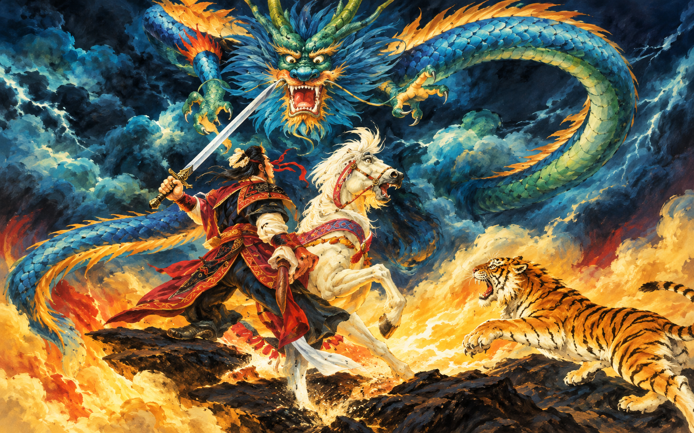

這是使用者選定的彩色前導原圖，執行期依固定畫布呈現，逐點動畫沿原版寫入順序。五頁文字使用深藍背景。原始提示與批准範圍見[來源紀錄](docs/images/story-prelude-color-approved-r1.json)，正式接入與驗收見 [014](docs/spec/014-intro-story-background.md#彩色前導正式追加驗收)。

### 兩側海報與字型工具列

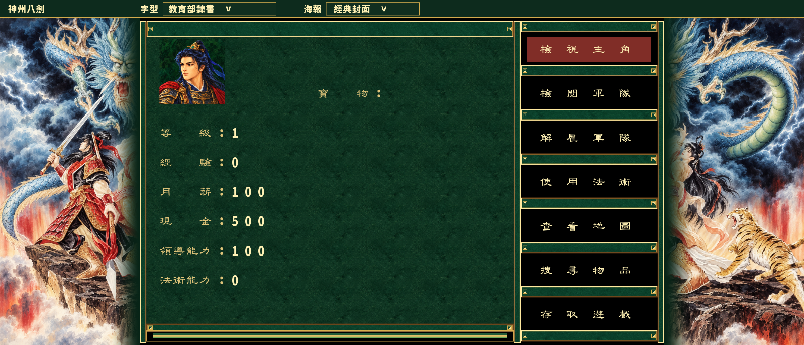

這是正式前端的實際視窗截圖。中央遊戲完整保留，兩側海報內緣漸淡；工具列可切換海報及字型，選單操作不會送進遊戲。海報可看[經典封面原圖](docs/images/poster-cover-approved-r1.png)與[龍虎延展原圖](docs/images/poster-wings-approved-r1.png)。兩張由內建 image_gen 依使用者提供的包裝參考繪製，原始 PNG、完整提示及[來源紀錄](docs/images/poster-approved-r1.json)保存於私人倉庫。

教育部隸書出自[教育部官方下載頁](https://language.moe.gov.tw/material/info?m=9fe3fb11-c3d5-41f2-b029-6d18a2c2fd0d)，署名中華民國教育部，沿原標示 CC BY-ND 3.0 TW。原始字型保持不變。已核對的 722 個中文字中，718 字直接使用，`佈崗歎秘` 四字以 Noto 宋體補足；英數與標點保留 Noto Black。舊素材組仍標示原有隸書風，不混稱教育部隸書。

已有本機 r26 及固定字型來源時，使用 `bash tools/player.sh moe-lishu-assets <新名稱> [基底名稱]` 製作教育部隸書組，再用 `bash tools/player.sh poster-toolbar-assets <另一個新名稱> <前一步名稱>` 加入海報。兩者都由 Docker 執行，拒絕覆寫輸出。前端參數 `-font noto|lishu|caoshu`、`-poster wings|cover|off` 可指定初始選擇；未指定便讀取使用者偏好。舊素材組的視窗尺寸保持原樣。

### 原版圖像完整盤點與 HD 覆蓋

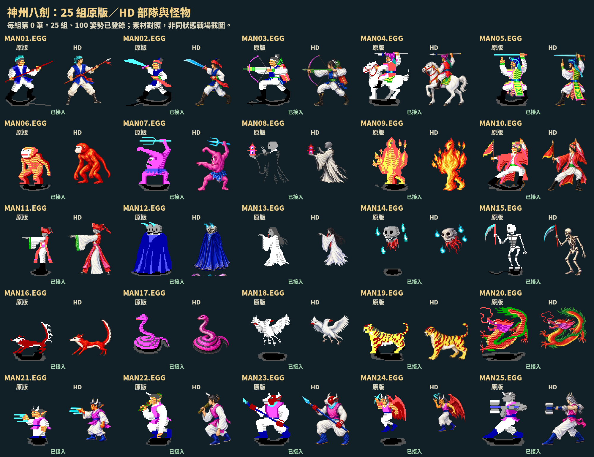

上圖列出 `MAN01` 至 `MAN25` 的全部 25 組，每組左側為第 0 筆原版，右側為 HD 圖片。100 個姿勢均已正式登錄；新增 20 組的原向與鏡射支援軍隊頁及戰場，兩種用途共用不可變快取。新增圖的四姿勢全貌可看[80 個姿勢總覽](docs/images/troops-new-hd-all-poses-r2.png)，完整原版另見[104 筆原版姿勢圖](docs/images/troops-all-poses-original-r1.png)。這些是素材圖集，沒有宣稱同狀態戰場對拍。

新圖沿已驗的共用機制抽樣。持刀兵、幽靈與龍以受控記憶體呼叫原版繪圖，兩向、軍隊用入口與戰場入口共 12 個完整畫面通過；正常視窗另驗三字型、人物／軍隊頁及真正存退讀。不逐隻等待自然遭遇，也不將受控測試稱為自然遭遇。`MAN27` 的四筆太極圖用途仍未證實，分開列入盤點。素材、提示與來源雜湊見[批次清單](docs/images/troops-hd-batch-r2.json)、[接入契約與抽驗](docs/spec/048-troop-hd-batch.md#正式接入與限定驗收)及[總覽工具](tools/prepare-troop-hd-overview.py)。完整 PNG 與提示留本機。

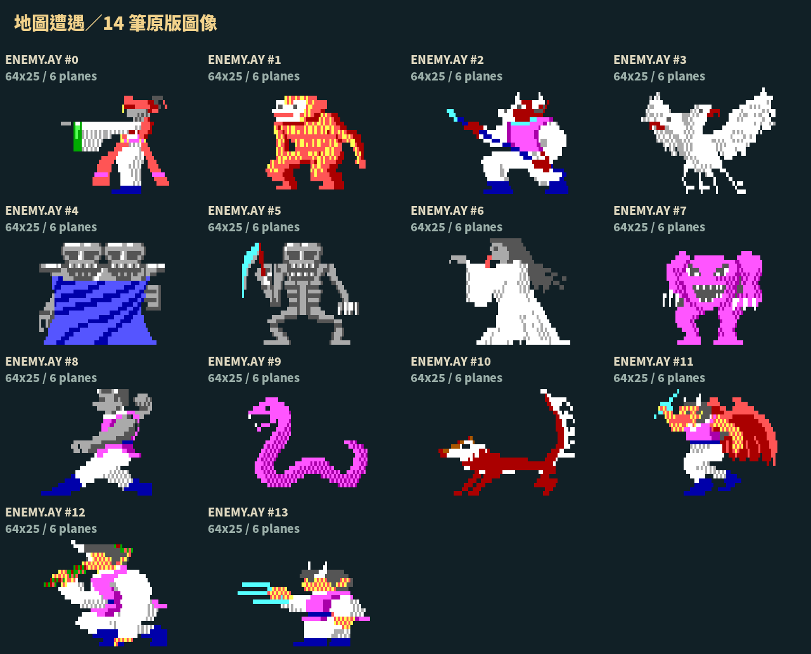

地圖遭遇另存於 `ENEMY.AY`，共有 14 筆，不包含在上面的 MAN 圖集中。原版檔名、記錄號與來源雜湊均保存在[圖形盤點清單](docs/images/graphics-inventory-r1.json)。

目前已逐檔盤點 158 個來源檔，解出其中 104 個圖形檔案、333 筆圖像記錄。下列數量包含動畫幀、原版變體及編輯圖集，不代表怪物種類或 HD 完成比例。此數量不含程式內字模及執行期生成的介面。尚有 `A.A` 與六份 `.RIL` 未完成分類，未宣稱已窮盡所有圖形。

| 類別 | 圖像記錄 | 完整原版圖集 |
|---|---:|---|
| MAN 角色／部隊來源 | 100 | [四筆逐組展開](docs/images/troops-all-poses-original-r1.png) |
| MAN27 太極圖，原版用途未證實 | 4 | [四筆來源](docs/images/original-special-markers-r1.png) |
| 地圖遭遇 | 14 | [ENEMY.AY](docs/images/original-map-encounters-r1.png) |
| 主角與圖示 | 29 | [MAN.AY 全部記錄](docs/images/original-hero-and-icons-r1.png) |
| 戰場效果 | 8 | [PON／CHOI](docs/images/original-effects-r1.png) |
| 地圖圖塊 | 68 | [PMAP.AY](docs/images/original-map-tiles-r1.png) |
| 戰場背景與原版變體 | 10 | [GRO01 至 GRO05](docs/images/original-battle-backgrounds-r1.png) |
| 建築與原版變體 | 12 | [LIVE1 至 LIVE6](docs/images/original-buildings-r1.png) |
| 開場圖像 | 26 | [TIT 系列](docs/images/original-opening-r1.png) |
| 結局圖像 | 37 | [END 系列](docs/images/original-ending-r1.png) |
| 介面圖像 | 6 | [CUBE／BUMBOO／MSGBOX](docs/images/original-ui-r1.png) |
| 原版編輯圖集與插畫 | 19 | [X 系列 ILBM](docs/images/original-illustrations-r1.png) |

盤點由[全圖形工具](tools/catalog-all-graphics.py)重生，並以 IDA Pro 9.4 核對 PAM 與開場程式的載入線索。圖集使用原始資料解碼，保留檔名與記錄號；檔名帶 `H` 代表來源變體，不能一律視為單色圖，也不是本專案的 HD。方法、位址基準與尚未證實項目見[圖形盤點研究](RESEARCH-LOG.md#全圖形來源盤點與-ida-載入線索)。

### 已接入的 HD 怪物樣本

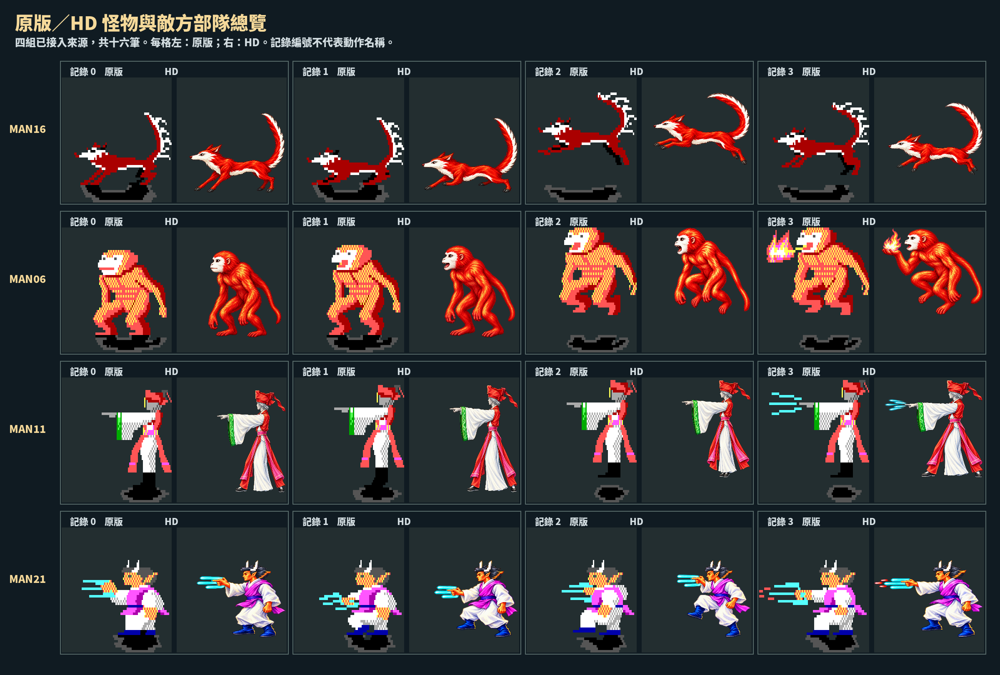

這是早期四組敵方部隊，共十六筆已接入來源。每格左側為原版六塊資料解碼，右側為遊戲實際使用的 HD 快取；保留原版顯示比例。檔名與記錄編號供核對，不推定兵種名稱或動作語意。範圍見 [023](docs/spec/023-battle-man16-actors.md)至 [026](docs/spec/026-battle-man21-actors.md)，全部25組見上方總覽。點圖可看原尺寸。

全部來源及未接入項目見前面的完整圖集；原[MAN 記錄盤點工具](tools/catalog-battle-coverage.py)仍保留檔案與 HD 登錄核對，不能單憑檔名推定兵種語意。

### 原版／HD 戰場總覽

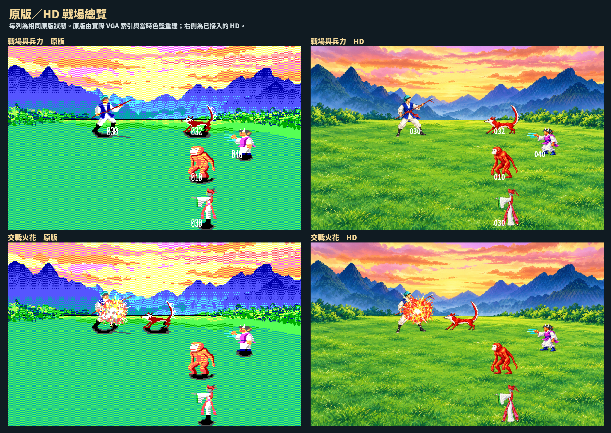

左側為 dosgolem 實際原生 VGA 索引與當時色盤重建，右側為相同客體狀態的 HD 畫面，包含手繪背景、敵方部隊、民兵及火花。兩列分別抽樣戰場兵力與交戰火花，不代表全遊戲已完成。來源及對拍見 [022](docs/spec/022-battle-bitmap-transactions.md)、[027](docs/spec/027-battle-pon-effects.md)與 [028](docs/spec/028-battle-militia-image.md)。

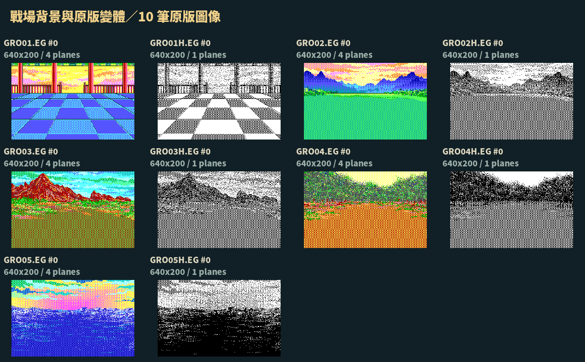

原版共有五份彩色 GRO 戰場背景及其五份原版單色變體。上圖全部列出；目前手繪接入範圍為 GRO01／GRO02，其他背景尚待處理。

同狀態戰場與舊怪物比較圖的[來源與輸出雜湊](docs/images/overviews-r1.json)及[重生工具](tools/prepare-readme-overviews.py)隨圖保存；新增完整原版圖集另由前述全圖形工具重生。比較文件依使用者要求收錄於既有私人倉庫，原始遊戲檔與完整素材組仍留本機。

### 原版／HD 攻城戰場

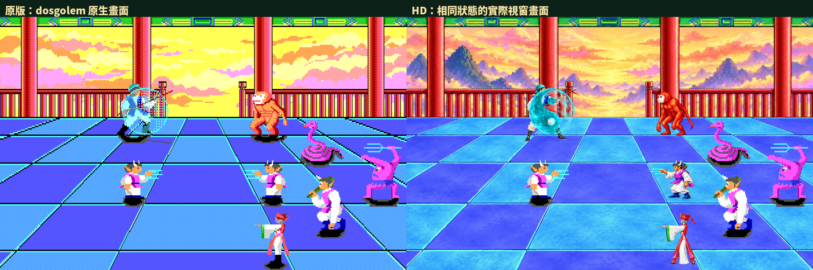

左側為 dosgolem 原生畫面，右側為同一客體狀態的實際視窗畫面。背景保留原版朱柱、金色山景與紫藍地板。攻城、撤退、三字型人物頁及真正存退讀已抽驗，範圍見 [046](docs/spec/046-castle-battle-background.md#正式接入與限定驗收)。圖中仍有原版部隊，友軍矮人的戰場鏡射動畫已依 [042](docs/spec/042-friendly-man21-battle-poses.md#正式接入與限定驗收)接入。[圖像紀錄](docs/images/battle-palace-original-hd-r1.json)及[重生工具](tools/prepare-readme-palace-overview.py)隨圖保存，完整美術留本機。

### 友軍矮人四個戰場姿勢

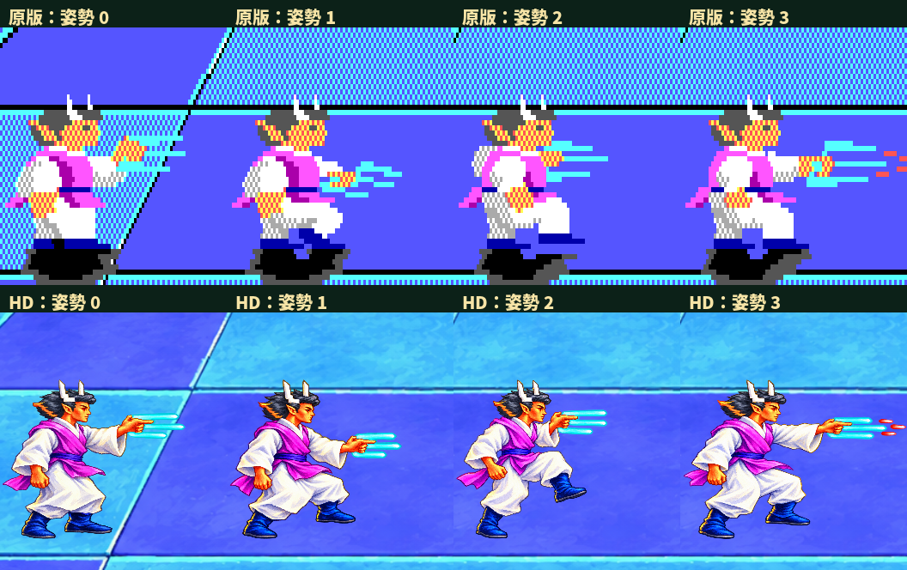

每欄上方是原版，下方是同一客體狀態的實際HD視窗圖。四個姿勢共用既有手繪素材，依原版來源鏡射，保留動作順序與位置；軍隊頁也維持已驗圖像。正常攻擊、撤退、Noto／隸書／草書及真正存退讀已抽驗，範圍見 [042](docs/spec/042-friendly-man21-battle-poses.md#正式接入與限定驗收)。[圖像紀錄](docs/images/friendly-man21-poses-original-hd-r1.json)與[重生工具](tools/prepare-readme-friendly-overview.py)隨圖保存，其他部隊尚未全部完成。

### 民兵三個戰場動作

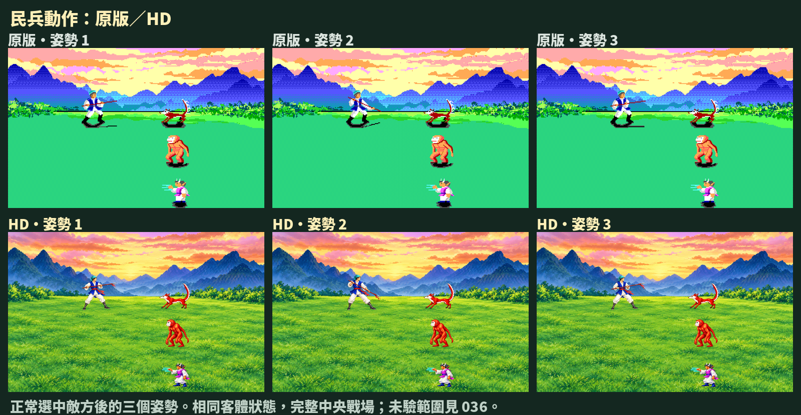

原版在上，HD 在下。三欄來自正常選中敵方後的實際返回點，每欄的完整客體狀態相同。連同既有待機圖，民兵四筆戰場姿勢皆已接入；真正視窗亦取得三個新姿勢及存退讀。來源與限定驗收見 [036](docs/spec/036-battle-militia-poses.md)，[圖像紀錄](docs/images/battle-militia-poses-original-hd-r1.json)與[重生工具](tools/prepare-readme-militia-overview.py)隨圖保存。比較圖沿使用者要求收錄於既有私人倉庫，完整原圖與素材組留本機。

### 地圖遭遇角色

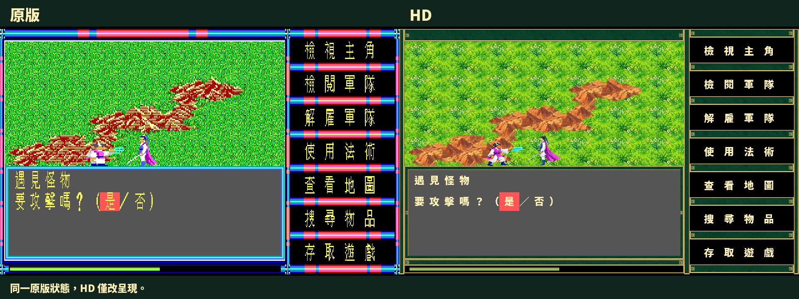

左側是原生 VGA，右側是同一正常流程狀態的 HD。紫衣角色保留白衣、藍靴與青色光束，依原版高度逐步出現及退場。已核對十段畫面、真正視窗的三種字型、人物頁與存退讀；範圍見 [037](docs/spec/037-map-encounter-actor.md)。[來源紀錄](docs/images/map-encounter-original-hd-r1.json)與[重生工具](tools/prepare-readme-encounter-overview.py)隨圖保存，其餘地圖遭遇圖仍待處理。比較圖依先前要求收錄於私人倉庫，完整原圖與素材組留本機。

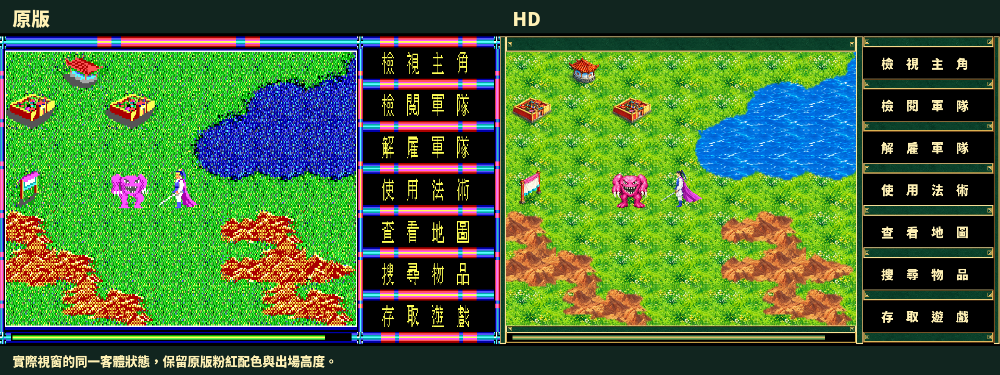

粉紅咧嘴怪物也已接入，保留原版配色、雙爪及逐段出場。上圖兩側來自真正視窗的同一客體狀態；已驗三字型、戰鬥返回、人物頁與存退讀。[限定驗收](docs/spec/039-map-encounter-pink-creature.md)、[來源紀錄](docs/images/map-encounter-7-original-hd-r1.json)及[重生工具](tools/prepare-readme-encounter7-overview.py)可回查。正式名稱仍未知，其餘遭遇角色繼續處理。

### 軍隊頁

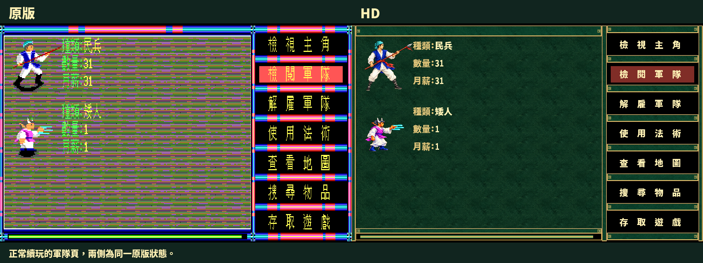

正常招募後，民兵與矮人的軍隊頁都使用 HD 圖像與 Noto 文字。矮人共用既有戰場手繪圖，在軍隊頁轉為右向；F2、F3 的三字型、取消返回與真正存退讀均已驗證。上圖來自正常續玩的相同原版狀態，視窗另有獨立驗收；[範圍與證據](docs/spec/041-army-man21-image.md)、[圖像紀錄](docs/images/army-man21-original-hd-r1.json)及[重生工具](tools/prepare-readme-army21-overview.py)可回查。其他兵種尚未全部完成。

### 地圖城堡

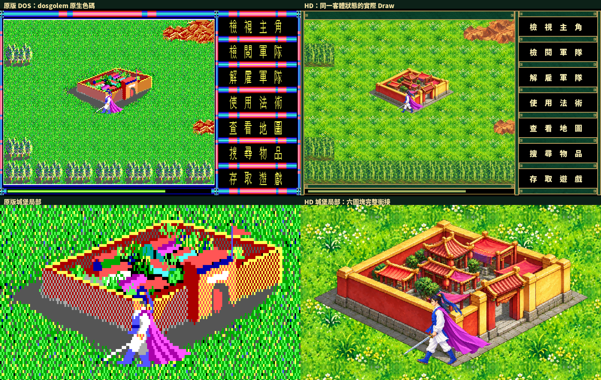

城堡由上排三塊、下排三塊組成，共用透明手繪全景，外圍銜接既有草地。左右來自同一正常續玩狀態，右側是實際中央畫面；三字型、主角、人物／軍隊往返、故障回退與真正存退讀均已驗證。[限定範圍](docs/spec/043-map-castle-parts.md#正式提升與限定驗收)、[圖像紀錄](docs/images/map-castle-original-hd-r1.json)及[重生工具](tools/prepare-readme-castle-overview.py)可回查。其他建築與整體 HD 尚未全部完成，完整原圖與素材仍留本機。

已有本機固定原圖、提示、合法資料與 r40 時，可用 `bash tools/player.sh castle-assets <新名稱> [基底名稱]` 重建城堡素材組；預設基底 r40，拒絕覆寫輸出。新增清單或圖片失敗時，只讓這六塊回退原版，其他 HD 保留。

地圖寶箱也已接入手繪圖，保留紅金箱體、藍色內蓋與開啟姿態，透明外圍銜接既有草地。正常續玩、三字型、人物／軍隊往返及真正存退讀均已驗；範圍見 [044](docs/spec/044-map-object-58.md#正式提升與限定驗收)。有本機固定原圖與 r41 時，可用 `bash tools/player.sh chest-assets <新名稱> [基底名稱]` 重建；圖片失敗只回退此寶箱。此項只改善呈現，沒有修改開箱規則或獎勵。

地圖上的灰藍框形物件也已換為手繪圖，透明外圍沿既有草地。三字型、人物／軍隊頁往返及真正存讀檔已驗；範圍見 [045](docs/spec/045-map-landmarks.md#正式提升與限定驗收)。目前只改善呈現，物件正式名稱與互動用途仍待查證。

另有兩筆太極圖與紅頂建築換為手繪圖，保留原版配色與配置，文字使用工具列選定的字型。三字型、人物／軍隊頁及真正存讀檔已驗；範圍見 [045](docs/spec/045-map-landmarks.md#第-49-與-54-筆正式提升)。也已走通太極圖轉區及新區域的三字型、人物／軍隊頁與存退讀，[跨區證據](docs/spec/045-map-landmarks.md#普通步行轉區)另列。正式名稱與紅頂建築用途仍待查證。

紅頂建築群與紅黃山形物件也已接入手繪圖，保留原版配置並銜接草地。正常續玩、三字型、人物／軍隊頁往返、故障回退及真正存退讀已驗；範圍見 [045](docs/spec/045-map-landmarks.md#第-52-與-56-筆正式提升)。這兩筆只改善呈現，正式名稱與互動用途仍待查證。

### 已選定的整體畫風

已確認採用下圖**下半部 B「明亮手繪重製」**的中國古風。上半部 A 保留比較歷史；圖檔與最初展示版本完全相同。文字另依已選定的 Noto Sans CJK TC Black 900 實作，圖中文字僅為生成示意。

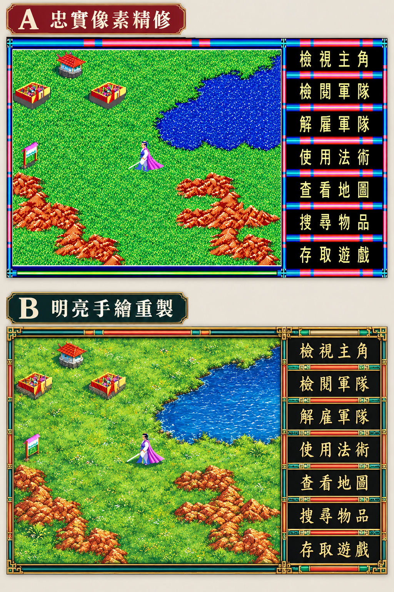

這是依新遊戲地圖製作的定稿樣式參考，尚非遊戲執行截圖。使用者已明確授權將本圖存入 GitHub；[批准與雜湊紀錄](docs/images/hd-style-approved-r1.json)及[原始生成提示](docs/images/hd-style-approved-r1.prompt.txt)隨圖保存，其他原版素材仍留本機。

本機另保留原始比較圖與字型樣張：

| 檔案 | 內容與限制 |
|---|---|
| `workplace/probe-20261023/hd-style-comparison-r1.png` | 依原版新遊戲地圖製作的生成草稿；上方 A 忠實像素，下方 B 明亮手繪。圖中文字為生成示意，不能作為字型或操作文字的證據 |
| `workplace/probe-20261023/noto-weight-comparison-r1.png` | 真實 Noto Sans CJK TC，左側 Bold 700、右側 Black 900；包含原版七項地圖指令與自製排版測試句，尚未接入遊戲 |

字型樣張可用 `bash tools/research.sh font-preview` 在 Docker 重生。需具備 `/usr/share/fonts/opentype/noto/NotoSansCJK-Bold.ttc` 與 `NotoSansCJK-Black.ttc`；工具會驗證繁體字面並保存字型及圖片雜湊。已有同名輸出時會停止，不覆寫。

目前已選定右側的 Noto Sans CJK TC Black 900。樣張用來確認字形與字重，實際遊戲內的字級、行距與安全範圍仍須逐欄位驗證。

## 研究環境與執行

提供無頭研究工具與開發用視窗前端。主機負責 Docker／Git 編排，遊戲、盤點、建置與驗證均在 Docker 執行。

必要輸入與依賴：

- 專案根目錄的 `8sword.zip` 與 `珍092-神州八劍.rar`。目前只接受[研究紀錄](RESEARCH-LOG.md)列出的固定雜湊，不自動套用其他版本。
- 本機 dosgolem 來源 `/home/anr2/cht/dosgolem`。建置工具另建隔離副本，固定提交並套用本案顯示頁補丁。
- Docker 映像 `mm3-research:20261015-r1`、`dosgolem-go-ebiten:1.24-r1`；圖片與收據核對另需 `sc-cht-hdtools:pillow11.3.0-r1`。映像身分由工具鎖定，目前須使用開發主機既有映像，尚未提供獨立環境安裝流程。

首次盤點及建置：

```bash
bash tools/research.sh intake
bash tools/research.sh build-probe
```

盤點會保留原始封包，解包至 `workplace/`，並拒絕覆寫既有來源。以下透過原版啟動器選擇 VGA／AdLib，執行至主選單，輸出畫面與快照：

```bash
bash tools/research.sh probe readme-boot \
  -exe /work/intake-20261023/sources/game/8sword/PREDELLA.EXE \
  -bios-keys 11 -bios-key-from 1000000 -bios-key-every 2000000 \
  -adlib -steps 125000000 \
  -dump-screen-png /out/screen.png \
  -save-state 124999999:/out/machine.state
```

收據保存在 `workplace/probe-20261023/readme-boot/`。每次 probe 使用新名稱；原版存檔寫入該次的 `scratch/`，不覆寫唯讀來源。續跑、按鍵與存讀檔收據用法見[研究紀錄](RESEARCH-LOG.md#可重播入口)。

```bash
bash tools/research.sh test
bash tools/research.sh audit
```

`test` 檢查相關核心套件。`audit` 核對已保存的原版流程收據與來源完整性，須先具備研究紀錄所列的本機收據；首次啟動輸出不能取代完整存退讀驗證。

Noto 前端的建置與驗證入口：

```bash
bash tools/player.sh dependencies
bash tools/player.sh assets
bash tools/player.sh build my-hd-build
bash tools/player.sh test
EIGHTSWORD_GUI_CYCLES=4000 EIGHTSWORD_GUI_VSYNC=false bash tools/player.sh gui-check noto-check
```

`dependencies` 僅在下載鎖定版依賴時開放容器網路，不掛入原版資料。`assets` 讀取上述 Noto Black 字型與固定版本 PAM，製作本機字型素材；已有輸出便停止。`gui-check` 在 Xvfb 真正操作視窗並保存畫面與連續幀，不是互動啟動命令。名稱須未使用，收據在 `workplace/player/gui/<名稱>/`；此處的 cycles 值是診斷設定，尚未定為正式執行速度。前端目前有明顯效能限制，不能以設定的 30 TPS 當成實測幀率。

覆繪規格、核心觀測補丁、狀態隔離及未驗範圍見 [003：Noto 執行期文字覆繪](docs/spec/003-noto-runtime-overlay.md)。字型素材、原版截圖與機器快照均留本機。

啟動時可看見原版 VGA／音效選項，英文換成 Noto，雙線框及 1／2／3 按鍵保留。驗證工具以實際呈現的提示送鍵；`EIGHTSWORD_GUI_FLOW=boot` 另測無效 Return、新遊戲及人物頁，字型損壞可用 `boot-fallback` 核對原字模。來源與限定驗收見 [010：啟動文字](docs/spec/010-boot-console-text.md)。

正常視窗存退讀可用 `EIGHTSWORD_GUI_FLOW=save-cycle` 選擇，測試會由原版 F7 儲存、正常回 DOS，再開另一個程序選「繼續」，不以快照取代讀檔。每輪保留建置來源、實際按鍵、逐幀畫面及原版檔案事件；[存退讀核對工具](tools/audit-save-cycle.py) 的範圍見 003。`EIGHTSWORD_GUI_RECORD=0` 與 `EIGHTSWORD_GUI_VSYNC=false` 只供效能比較，不代表正式播放設定。

視窗收據的 `stage_totals` 保存模擬、音訊、合成、上傳與錄製的累計成本，`session` 分開列出實際時間與 dosgolem 模型虛擬時間。重複畫面錄製會保留每次呈現與步數，減少掃描相同畫素；格式及驗證範圍見 [003 的成本量測](docs/spec/003-noto-runtime-overlay.md#呈現與錄製成本)。近期幀率、全程平均與單次合成耗時須分開判讀。

HD 圖像使用本機生成原圖，不隨倉庫提供。[匯入工具](tools/prepare-hd-graphics.py)要求固定地表、玉紙、肖像、三張靜物與十二張透明主角 PNG 及原始提示，來源路徑及雜湊見[004 圖像規格](docs/spec/004-hd-bitmap-presentation.md)、[006 靜物與沙地規格](docs/spec/006-static-map-objects-and-sand.md)、[007 主角動作規格](docs/spec/007-masked-hero-animation.md)及研究紀錄。已具備這些輸入後，可建立新的素材組再驗證：

```bash
bash tools/player.sh graphics-assets painted-r8
EIGHTSWORD_GUI_ASSETS=/bin-player/assets-painted-r8 \
  EIGHTSWORD_GUI_CYCLES=4000 EIGHTSWORD_GUI_VSYNC=false \
  EIGHTSWORD_GUI_FLOW=save-cycle bash tools/player.sh gui-check painted-check
```

圖像組包含 Noto 字集，透過 `-assets` 選用，不覆寫原版檔案。岸線、山地與沙地按原圖色群柔化，是視覺近似；三張靜物依原版構圖重繪，透明區預先合成於草地。主角另有透明圖層，只在來源與完整底圖可確認時抹除原版身形並合成，朝向與幀序仍由原版控制。金玉介面依原版矩形以程式繪製，未知圖像保留原版。圖像損壞時整組停用，保留已驗證的 Noto，並在視窗標題顯示原因。無頭[隔離核對工具](tools/audit-player.py)的 `--graphics` 要求圖像確實啟用，`--actors` 另要求十二張主角素材與真實人物合成。匯入命令第三參數可選 `ground`、`landscape`、`portrait`、`interface`、`objects` 或預設 `current`；前五者重建較早的素材組。未備本機圖像時，測試工具明示跳過圖像測試，仍可驗證字型。

正常存退讀的視窗驗證可另設 `EIGHTSWORD_GUI_ACTOR_WALK=1`，在儲存前透過 XTEST 增加四方向移動及人物頁往返。這是驗證選項，不會改正式遊戲規則；逐一遍歷十二種原版動作及其餘背景仍須另外確認。

更多新遊戲選單可設 `EIGHTSWORD_GUI_FLOW=menus`，在相同 Docker 視窗工具測 F2 軍隊、F3 解雇頁及取消、F4 無法施法提示、F5 地圖位置。此流程只檢查新遊戲已有的民兵與未習得法術狀態；習得後施法及其他戰鬥分支另驗。

F2 的初始民兵已有手繪 HD 圖，保留藍背心、白褲、青頭巾與持槍方向。來源、[可重現匯入工具](tools/prepare-hd-army.py)及軍隊頁限定驗收見 [018](docs/spec/018-army-militia-image.md)。存退讀流程另設 `EIGHTSWORD_GUI_ARMY_CHECK=1`，在新遊戲及繼續進度後各測兩次 F2／F1 往返。

F3 解雇頁亦使用同一張 HD 民兵，保留原版黑底與選取文字。[黑底匯入工具](tools/prepare-hd-black-panel.py)使用 `bash tools/player.sh black-panel-assets <新名稱> [基底名稱]`，預設基底 r32。存退讀流程加 `EIGHTSWORD_GUI_DISMISS_CHECK=1`，可驗三字型、Esc 取消、原版 Enter、空軍隊及重新讀取。正常與故障驗收見 [018 追加](docs/spec/018-army-militia-image.md#f3-黑底追加驗收)，沒有修改軍隊規則或新增存檔欄位。

募兵建築已採用使用者選定的[手繪城門](docs/images/recruitment-gate-approved-r1.png)，保留原版朱紅屋頂、綠色簷飾、赭色城牆及閉合城門。[匯入工具](tools/prepare-hd-recruitment.py)用法為 `bash tools/player.sh recruitment-assets <新名稱> [基底名稱]`，預設基底 r33；沒有修改募兵規則。視窗存退讀流程加 `EIGHTSWORD_GUI_RECRUITMENT_CHECK=1`，以普通按鍵走到建築、切換 Noto／教育部隸書／草書並取消返回。來源、批准提示與驗收範圍見 [034](docs/spec/034-recruitment-building.md)，獨立像素核對入口為 [audit-recruitment.py](tools/audit-recruitment.py)。新建築資產失敗只回退這張圖，其他 HD 保留。

主鍵盤 `0–9` 與 `Backspace` 會送給原版程式，支援募兵數量輸入與退格。`EIGHTSWORD_GUI_RECRUITMENT_HIRE_CHECK=1` 搭配 `EIGHTSWORD_GUI_FLOW=save-cycle`、`EIGHTSWORD_GUI_ARMY_CHECK=1`，可測數字 4–9、退格清空、10 改為 1、募兵及讀回後的軍隊／人物頁。原版結果與 Noto 輸入欄由 [audit-recruitment-input.py](tools/audit-recruitment-input.py)獨立核對，範圍見 [003 數字追加](docs/spec/003-noto-runtime-overlay.md#主鍵盤數字與退格的原版輸入路徑)。

地圖竹林已沿同一手繪風格補齊，保留原版格子、遮擋與捲動。[匯入工具](tools/prepare-hd-bamboo.py)用法為 `bash tools/player.sh bamboo-assets <新名稱> [基底名稱]`，預設基底 r35；須具備本機原圖與完整提示。來源、正常續玩、存退讀及故障回退範圍見 [006 的竹林追加](docs/spec/006-static-map-objects-and-sand.md#pmap-45-竹林追加)，獨立核對入口為 [audit-bamboo.py](tools/audit-bamboo.py)。竹林圖損壞時沿既有地表整組回退，Noto 保留。

民兵其餘三個戰場姿勢使用 `bash tools/player.sh battle-man01-assets <新名稱> [基底名稱]` 匯入，預設基底 r36；需要本機三張原圖、完整提示與固定原版。三筆整組載入，壞新圖只停用新增姿勢，首筆與 F2 共用圖保持。[獨立核對工具](tools/audit-battle-man01.py)比較正常三組及真正視窗，契約見 [036](docs/spec/036-battle-militia-poses.md)，沒有修改攻擊、傷害或 AI 規則。

戰場已共用這張民兵首筆圖，沿原版背景頁入口啟用，F2 的來源分類保持。正常戰場、火花共存、返回與真正存退讀已核對，完整狀態見 [028](docs/spec/028-battle-militia-image.md)。已有本機 r22 後，用 `bash tools/player.sh battle-militia-assets <新名稱>` 加入可選對應。錯誤的新清單只停用戰場對應，共用 PNG 損壞仍依 018 的整組圖像回退。其他三筆民兵來源與其餘兵種另行驗證。

人物頁主角已改為中國武將美男子，採束髮金冠、深色甲冑與紅披風，保持原版肖像位置及人物資料。來源、限定對拍與存退讀見 [004 的武將肖像更新](docs/spec/004-hd-bitmap-presentation.md#主角武將肖像更新)。已有本機 r23 與規格所列原圖／生成紀錄後，用 `bash tools/player.sh hero-redesign-assets <新名稱>` 建立新組；肖像原圖留本機。

友軍矮人鏡射使用 `bash tools/player.sh friendly-man21-assets <新名稱> [基底名稱]` 匯入，預設基底r47。只加固定對應清單，不複製新PNG；四姿勢整組驗證，失敗保留原向與軍隊頁圖像。[契約與驗收](docs/spec/042-friendly-man21-battle-poses.md#正式接入與限定驗收)不改部隊或AI規則。

攻城背景使用 `bash tools/player.sh palace-assets <新名稱> [基底名稱]` 匯入，預設基底 r46；需要已記錄的本機手繪圖、完整提示與固定原版。現行本機圖像組為 `workplace/player/assets-painted-r49`，以前端 `-assets` 選用。原 `workplace/player/assets` 保留純字型基底。攻城背景與山谷背景各自驗證、各自回退，契約及核對入口見 [046](docs/spec/046-castle-battle-background.md#正式接入與限定驗收)。

新增部隊使用 `bash tools/player.sh troops-assets <新名稱> painted-r48` 批次重建，保留 r48 的 223 份素材，再加入 20 組四姿勢。須具備本機固定圖集與提示；工具拒絕覆寫既有輸出。來源、兩向、軍隊／戰場對應、各組回退及受控抽驗範圍見 [048](docs/spec/048-troop-hd-batch.md#正式接入與限定驗收)，完整性核對入口為 [audit-troops.py](tools/audit-troops.py)。

視窗支援原版戰鬥的 V 與左右 Ctrl，兵力及撤退結果沿用 Noto；結果訊息需由玩家普通按鍵關閉。正常遭遇、撤退、結果關閉及後續存退讀範圍見 [020](docs/spec/020-battle-result-presentation.md)。驗證時可在 `save-cycle` 另設 `EIGHTSWORD_GUI_BATTLE_CHECK=1`。[手繪戰場背景](docs/spec/021-battle-background-pages.md)以[完整幀與返回點快取](docs/spec/022-battle-bitmap-transactions.md)避免呈現尚未寫完的平面；首組敵方部隊 MAN16 的四筆圖像亦已接入，正常呈現、Noto、故障、隔離及存退讀範圍見 [023](docs/spec/023-battle-man16-actors.md)。其餘部隊與戰鬥美術仍依 [019](docs/spec/019-normal-encounter-battle-presentation.md)接續。

已有本機 r17 與 023 所列固定原圖及提示時，執行 `bash tools/player.sh battle-actor-assets <新名稱>` 建立新組，再以視窗的 `-assets` 指定該目錄。[匯入工具](tools/prepare-hd-battle-actors.py)保留原始 PNG，拒絕覆寫既有輸出；新圖像與完整提示留本機。

MAN06 的四筆來源與位置另見 [024](docs/spec/024-battle-man06-actors.md)。備齊本機 r18 與規格列出的原圖及提示後，用 `bash tools/player.sh battle-man06-assets <新名稱>` 加入第二組；兩組各自驗證，缺失或壞檔只回退該組。

MAN11 四筆另見 [025](docs/spec/025-battle-man11-actors.md)。備齊本機 r19 與規格所列原圖及提示後，用 `bash tools/player.sh battle-man11-assets <新名稱>` 加入第三組。三組各自完整驗證與載入；任一組壞檔時，其餘組與 Noto 保持。正常流程已取得四筆畫面，實際視窗抽驗第 0 筆，不外推其他動畫。

MAN21 四筆另見 [026](docs/spec/026-battle-man21-actors.md)。備齊本機 r20 與規格所列四張原圖及完整提示後，用 `bash tools/player.sh battle-man21-assets <新名稱>` 加入第四組。四組各自完整驗證與載入；正常續玩的實際視窗已取得四筆來源返回及畫面，並完成存退讀。此為圖像呈現驗收，不代表戰鬥規則或全遊戲已驗證。

PON 火花另見 [027](docs/spec/027-battle-pon-effects.md)。備齊本機 r21、規格所列四張選定原圖與完整提示後，用 `bash tools/player.sh battle-pon-assets <新名稱>` 加入。效果保留原版呼叫順序並累積透明圖，不改傷害或戰鬥規則。四筆正常返回畫面、實際視窗的完整快取與真正存退讀已抽驗；壞圖只停用火花，其餘 HD 保持。

片頭標題以原版實際繪圖及完整來源指紋驅動，四字改用 Noto Black 900，保留原位置、黑底及原版 Esc。字圖損壞時回原版標題，其他 HD 保留。來源、幾何及驗證範圍見 [011](docs/spec/011-intro-title-noto.md)。已有本機 r9、固定 TIT2 及上述 Noto 字型後，可建立新組：

```bash
bash tools/player.sh intro-assets painted-r10 painted-r9
bash tools/player.sh build my-hd-build
EIGHTSWORD_GUI_ASSETS=/bin-player/assets-painted-r10 \
  EIGHTSWORD_GUI_CYCLES=4000 EIGHTSWORD_GUI_VSYNC=false \
  EIGHTSWORD_GUI_FLOW=intro bash tools/player.sh gui-check title-window-check
```

`intro-skip` 在實際標題時送原版 Esc，`intro-fallback` 搭配真正壞圖組與 `EIGHTSWORD_GUI_NATIVE_FRAME` 核對原版標題。存退讀設 `EIGHTSWORD_GUI_FLOW=save-cycle EIGHTSWORD_GUI_SHOW_INTRO=1`，兩個冷啟動程序都先呈現 Noto 標題。這些是視窗驗證選項，仍由原版處理輸入與存檔；片頭素材不隨倉庫提供。

開場故事的五頁直排文字另有 Noto 字集，逐字與換頁均由原版呼叫驅動。r11 保留原版背景，新組可選已批准的深藍手繪背景。來源與限制見 [012](docs/spec/012-intro-story-noto.md)及 [014](docs/spec/014-intro-story-background.md)。已有 r10、經正常流程擷取並核對的執行期來源及同一字型後，可執行：

```bash
bash tools/player.sh story-assets painted-r11 painted-r10
bash tools/player.sh build my-hd-build
EIGHTSWORD_GUI_ASSETS=/bin-player/assets-painted-r11 \
  EIGHTSWORD_GUI_CYCLES=3000 EIGHTSWORD_GUI_FLOW=story \
  bash tools/player.sh gui-check story-window-check
```

`story` 等待完整片頭、五頁故事及自然交接，再操作正常選單；`story-skip` 在故事中按 Esc。存退讀另設 `EIGHTSWORD_GUI_FLOW=save-cycle EIGHTSWORD_GUI_SHOW_STORY=1`，兩次冷啟動皆先呈現故事。缺少或損壞故事字集時保留原字，標題、PAM Noto、圖像與音樂獨立保留。匯入拒絕覆寫既有素材組。

博物館的四組製作名單重用 r11 字集，按原版背景頁繪製及翻頁顯示，保留空格、青色及原位置。契約與驗證範圍見 [013](docs/spec/013-intro-museum-captions.md)。已有 r11 後可驗證正常完整開場：

```bash
EIGHTSWORD_GUI_ASSETS=/bin-player/assets-painted-r11 \
  EIGHTSWORD_GUI_CYCLES=3000 EIGHTSWORD_GUI_FLOW=captions \
  bash tools/player.sh gui-check captions-window-check
```

存退讀另設 `EIGHTSWORD_GUI_FLOW=save-cycle EIGHTSWORD_GUI_SHOW_CAPTIONS=1`，兩次冷啟動皆先呈現製作名單，再以原版 Esc 接續。字幕和故事共用字集，損壞時兩者回原字；標題、PAM Noto、圖像與音樂保持。這些是驗證選項，不修改原版流程。

博物館左右展間、十個人物動作、畫作近景與光束已正式接入，保留原版劇情與播放順序。素材、動態對照與限定驗收見 [開場 HD 規格](docs/spec/017-intro-museum-art.md)。鏡中美人的概念圖另作美術參考。

建置指令`bash tools/player.sh build <新候選名稱>`會保存獨立來源與七程式，拒絕覆寫。測候選版時，設定`EIGHTSWORD_GUI_BUILD=<候選名稱>`再使用`gui-check`；省略時使用已驗收的本機播放器。正式來源核心的重建、核對與提升入口見[047](docs/spec/047-hd-scene-renderer.md#正式提升與限定驗收)，建置本身不代表驗收通過。

## 字型設定與故事背景

預設為 Noto Sans CJK TC Black 900。載入可選字型組後，可按 **F10** 循環切換 Noto、隸書風 UnYetgul、劉建毛草。視窗標題顯示目前字型；主選單、人物頁、片頭標題、故事與製作名單同步切換。原文、字色與位置保持。英數與標點沿用 Noto Black，替代字型的中文缺字用 Noto 宋體補足，不把繁體換成簡體。

偏好存於系統使用者設定目錄的 `8sword/settings.json`，重新開啟後沿用。它與原版進度檔分開。在容器內啟動前端時，可加 `-font noto`、`-font lishu` 或 `-font caoshu` 指定並保存；`-settings <路徑>` 可指定獨立偏好檔。未知或損壞選項保留 Noto，不影響圖像及音樂。

| 字型 | 用途與來源 |
|---|---|
| Noto Black 900 | 預設、數值與缺字回退，沿用固定字型及 SIL OFL 1.1 |
| UnYetgul | 漢字呈隸書風，來源為 [CTAN Unfonts-extra](https://ctan.org/tex-archive/fonts/unfonts-extra)。GPLv2 沒有字型嵌入例外，目前僅作本機外掛，未加入 Git 或公開發行包 |
| 劉建毛草 | 可選草書，來源為 [作者倉庫](https://github.com/googlefonts/liujianmaocao)，SIL OFL 1.1。部分繁體字需由 Noto 補足 |

字型選型、固定輸入及驗證範圍見 [015](docs/spec/015-font-settings.md)。已有本機批准的深藍原圖、r11 與規格所列字型來源後，依序建立新素材組：

```bash
bash tools/player.sh story-background-assets painted-r12 painted-r11
bash tools/player.sh font-choices-assets painted-r14 painted-r12
bash tools/player.sh build my-hd-build
EIGHTSWORD_GUI_ASSETS=/bin-player/assets-painted-r14 \
  EIGHTSWORD_GUI_CYCLES=3000 EIGHTSWORD_GUI_FLOW=save-cycle \
  EIGHTSWORD_GUI_FONT_CYCLE=1 EIGHTSWORD_GUI_SHOW_STORY=1 \
  bash tools/player.sh gui-check font-save-check
```

背景損壞只回原底圖，故事文字仍可使用已驗證字型；替代字型損壞只停用該選項。原版圖片、生成背景、字型、atlas 與研究收據留本機。上述命令是 Docker 驗證入口，不代替正式打包或真機驗收。

## HD 音樂

原版控制選曲與停止，前端替換已提供的音樂。〈幻〉保留原曲音符、節奏及滑音，採已批准的撥弦與長笛方向；Koto／Flute 取樣不宣稱真正古箏、竹笛錄音。缺少 HD 曲目時播放原版，損壞音樂不連帶關閉 Noto 或圖像。

片頭使用相同〈幻〉，已接入原版初始化與停止事件。正常略過或自然結束後會停歌，再由主選單管理；標題與故事的 Noto 接入見 011／012，其餘片頭美術與文字仍待替換。

已具備本機批准的 Ogg 與配樂研究輸入後，可在既有圖像組上加入音樂：

```bash
bash tools/player.sh music-assets painted-r9 painted-r8
bash tools/player.sh build my-hd-build
bash tools/player.sh music-check music-hd-check painted-r9
EIGHTSWORD_GUI_ASSETS=/bin-player/assets-painted-r9 \
  EIGHTSWORD_GUI_CYCLES=4000 EIGHTSWORD_GUI_VSYNC=false \
  EIGHTSWORD_GUI_FLOW=music EIGHTSWORD_GUI_RECORD_AUDIO=1 \
  bash tools/player.sh gui-check music-window-check
```

無頭工具預設完整播放 90 個虛擬秒，再測重播、換曲及人物頁。視窗工具使用真正按鍵，並記錄前端混音；驗證容器維持靜音，不代替真機音訊裝置驗收。獨立波形、狀態及故障核對方法見 [008](docs/spec/008-music-events-and-playback.md)。原版音訊時鐘及合成器持續運作，沒有改 DOS 的曲譜、存檔或遊戲規則。音樂、音源庫及原版對照均留本機。

發行商畫面的「軟體世界」及公司／年份文字隨 F10 切換。中央圖案採使用者選定的 [B 柔和漸層](docs/images/publisher-icon-gradient-approved-r1.png)，保留笑臉、棋格帽、旋翼與彩色星形，字型及位置保持。[批准紀錄](docs/images/publisher-icon-gradient-approved-r1.json)與[曲線來源](docs/images/publisher-icon-gradient-approved-r1.svg)隨圖保存。固定來源、清墨遮罩、逐幀核對及故障回退見 [016](docs/spec/016-publisher-wordmarks.md)。

具備本機 r31 與合法原版 TIT1 後，執行 `bash tools/player.sh publisher-icon-assets <新名稱>` 建立包含圖案的新組，不覆寫基底。圖案缺失或損壞時保留原版中央圖案，HD 文字與其他素材繼續使用。視窗驗證使用 `EIGHTSWORD_GUI_SHOW_PUBLISHER=1 EIGHTSWORD_GUI_PUBLISHER_FONT_CYCLE=1` 搭配 `save-cycle` 流程及新素材組。原有字圖組仍可用 [文字匯入工具](tools/prepare-hd-publisher.py)建立，兩組的[像素核對工具](tools/inspect-publisher.py)相同；完整執行期素材留本機。

## 文件與權利

- [海報與工具列規格](docs/spec/032-poster-toolbar.md)：完整遊戲區、海報漸淡、選單輸入隔離及偏好保存。
- [原概念圖修色規格](docs/spec/031-hd-palette-refinement.md)：來源字格限定的暖金與朱紅，保留原風格及故障回退。

- [AGENTS.md](AGENTS.md)：工作規則與索引。
- [CONTEXT.md](CONTEXT.md)：唯一目前狀態表與下一步。
- [RESEARCH-LOG.md](RESEARCH-LOG.md)：來源、工具、原版流程與驗證證據。
- [PAM 字碼與字模規格](docs/spec/002-pam-font-catalog.md)：636 字對照、字型製作入口與限定驗收。
- [執行期文字覆繪規格](docs/spec/003-noto-runtime-overlay.md)：實際繪字、顯示頁搬移與開發用前端驗證。
- [HD 圖像規格](docs/spec/004-hd-bitmap-presentation.md)：圖像來源、角色遮罩、材質取樣與岸線美化。
- [古風介面規格](docs/spec/005-jade-gold-interface.md)：金玉外框、選單、訊息框及限定正常操作驗收。
- [靜物與地表規格](docs/spec/006-static-map-objects-and-sand.md)：兩種建築、布旗、已驗竹林，以及尚待正常場景驗收的沙地。
- [主角動作規格](docs/spec/007-masked-hero-animation.md)：十二張動作圖、底圖還原與人物所有權；正常四方向及存退讀驗證範圍。
- [民兵其餘戰場姿勢](docs/spec/036-battle-militia-poses.md)：三筆鏡射來源、正常目標選擇、完整圖重建及實際視窗，與 028 的首筆合成四姿勢。
- [音樂事件與播放規格](docs/spec/008-music-events-and-playback.md)：原版請求、Ogg 清單、混音及正常操作驗證。
- [片頭音樂交接規格](docs/spec/009-intro-music-handoff.md)：PREDELLA 的獨立入口、原版停止及 PAM 覆蓋載入後的掛勾隔離。
- [啟動文字規格](docs/spec/010-boot-console-text.md)：VGA／音效提示的 Noto 呈現、原字模回退及正常鍵盤流程。
- [片頭標題規格](docs/spec/011-intro-title-noto.md)：TIT2 壓縮來源、Noto 字圖、只讀呈現交易與 PAM 交接。
- [開場故事規格](docs/spec/012-intro-story-noto.md)：原文、直排字集、逐字呈現、換頁與 PAM 交接。
- [博物館名單規格](docs/spec/013-intro-museum-captions.md)：背景頁的製作名單、Noto 覆繪及清除。
- [深藍故事背景規格](docs/spec/014-intro-story-background.md)：批准圖、完整背景替換、換頁及故障回退。
- [字型設定規格](docs/spec/015-font-settings.md)：Noto、隸書風、草書、缺字回退、F10 及獨立偏好檔。
- [發行商畫面規格](docs/spec/016-publisher-wordmarks.md)：來源分離、三字型字圖、柔和漸層圖案及正常片頭交接。
- [Ogg 解碼器授權紀錄](docs/THIRD-PARTY-NOTICES.txt)：固定版本的第三方 MIT 授權全文。
- [WORKLOG.md](WORKLOG.md)：實際變更與工作歷程。

自有程式採 [RRSAL-1.0 source-available 授權](LICENSE)：非商業使用免費，允許實況與展示，商業使用另洽。此授權不涵蓋原版素材，第三方元件及字型保留各自授權。原版遊戲、手冊及衍生素材的權利不因轉檔或重製而改變。本專案為獨立保存與重製工作，未宣稱與原作者或發行商有隸屬關係。
